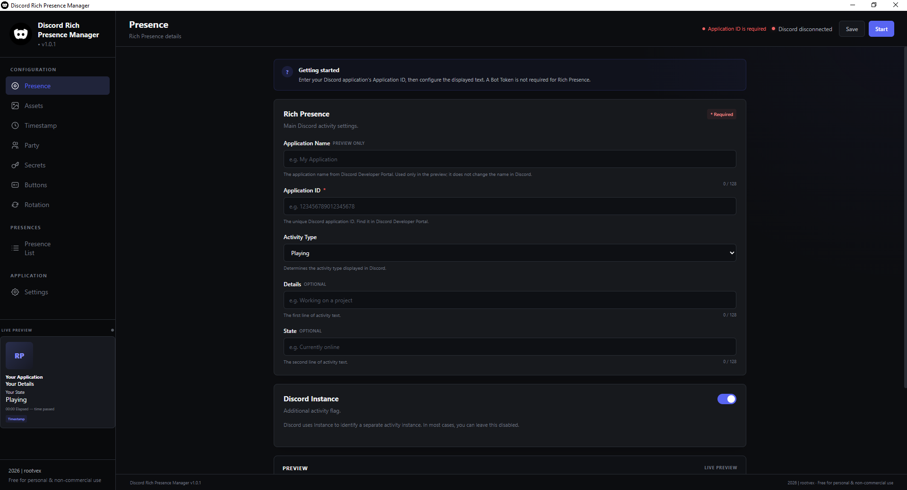
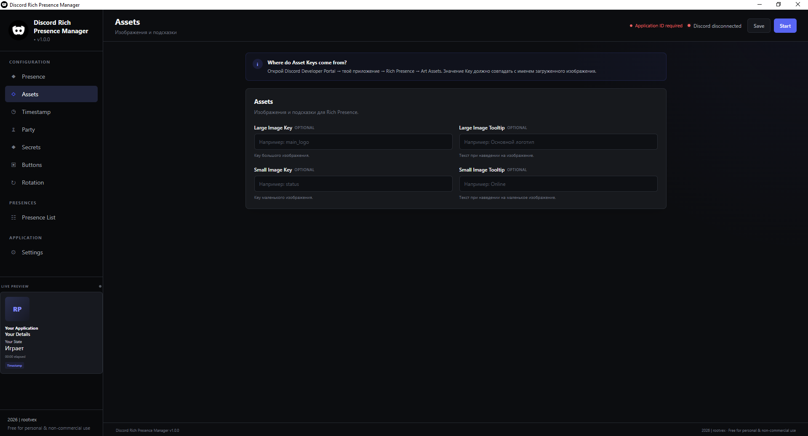
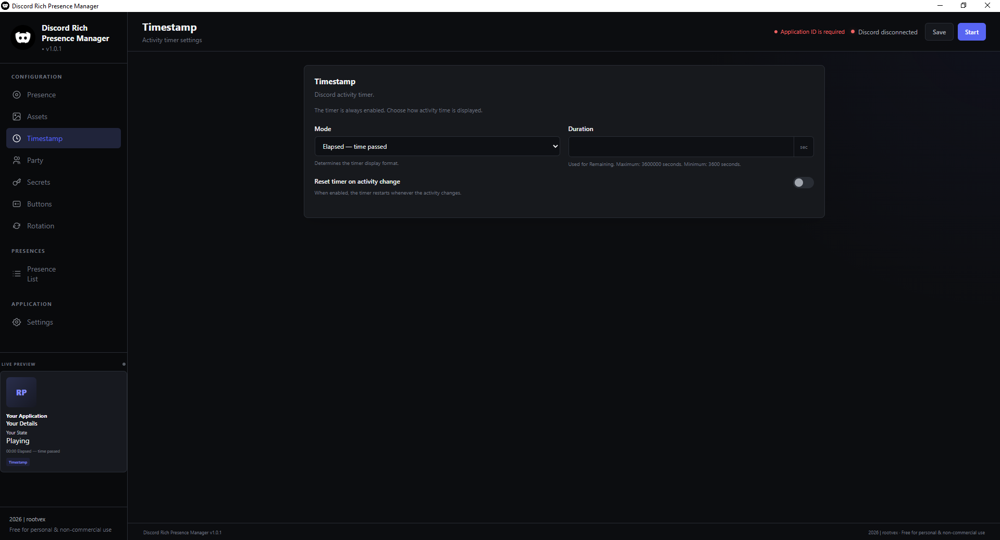
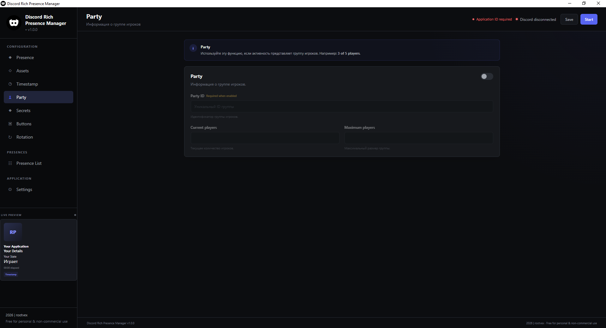
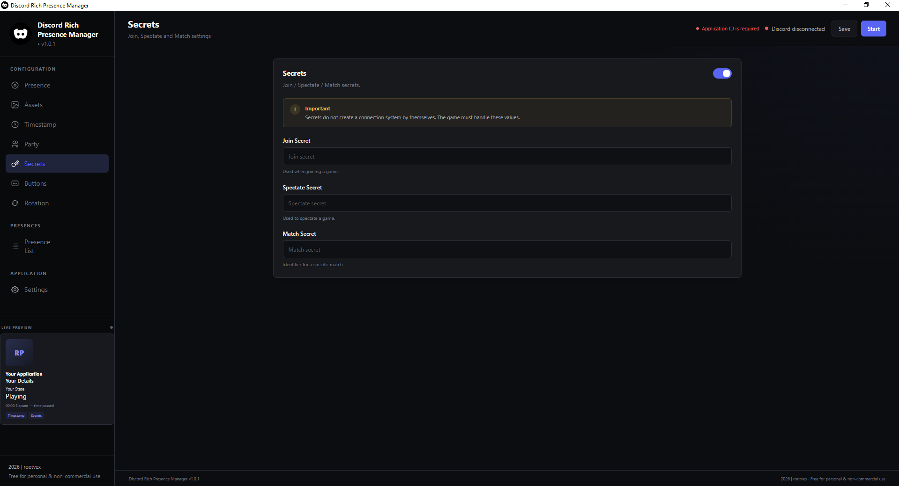
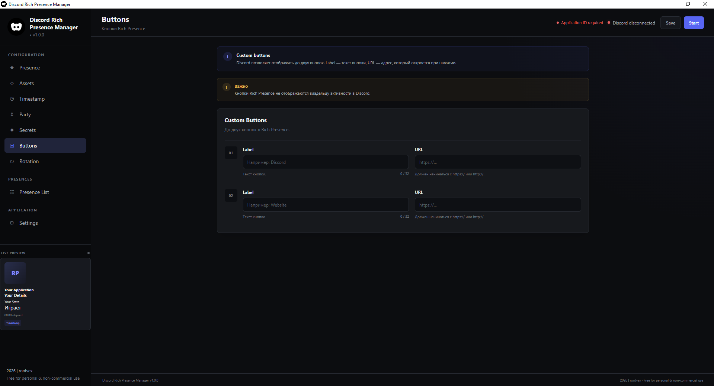
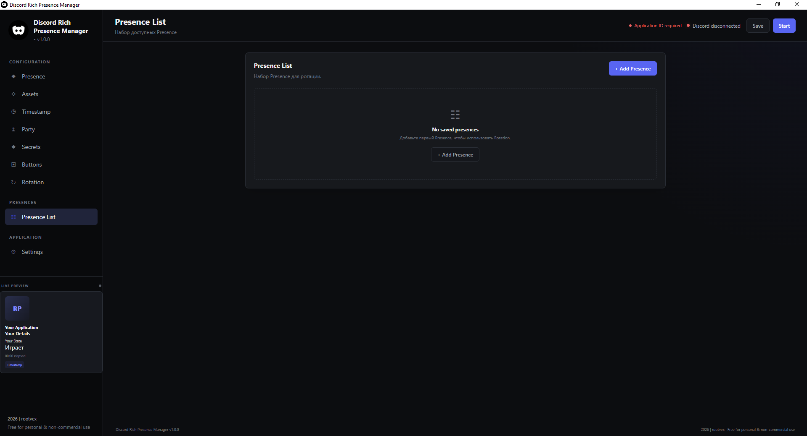
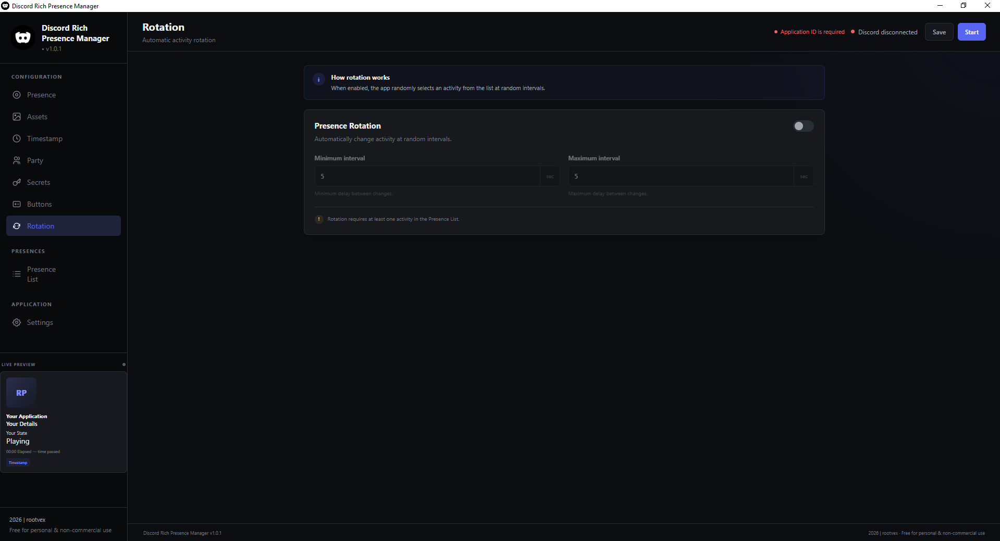
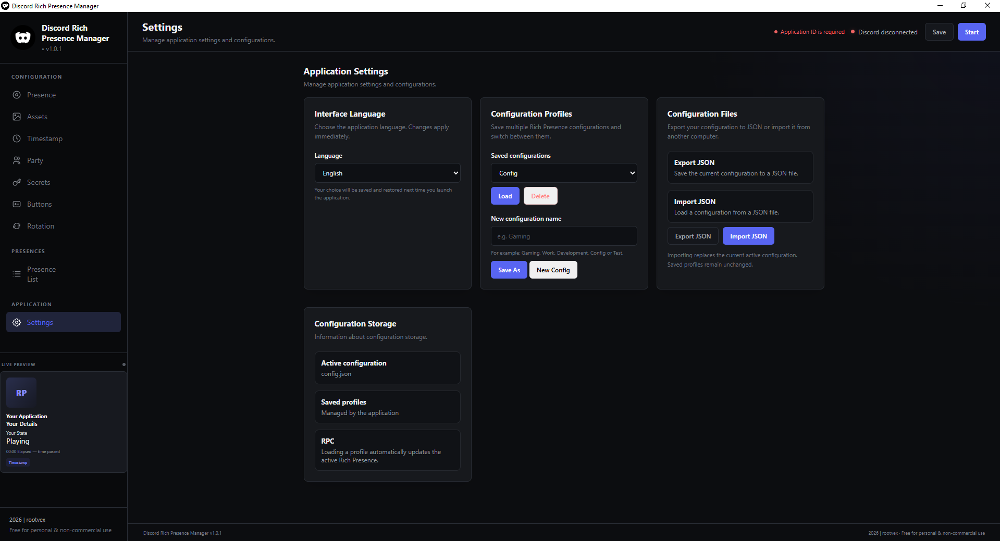

# Discord Rich Presence Manager

**Discord Rich Presence Manager** - приложение для настройки и управления Discord Rich Presence.

- **Автор:** rootvex
- **Версия:** 1.0.1
- **Платформа:** Windows x64

## Возможности

- Установка деталей активности: **Details** и **State**
- Выбор типа активности: **Playing**, **Listening**, **Watching** и **Competing**
- Предварительный просмотр оформления активности
- Поддержка русского и английского языков интерфейса
- Выбор изображений для активности
- Выбор таймера активности: **Elapsed** и **Remaining**
- Настройка **Party** (информация о группе игроков)
- Настройка **Secrets** (присоединение к матчу через активность)
- Установка до двух кастомных кнопок для активности
- Настройка **Rotation** (смена активности через случайный интервал)
- Создание нескольких активностей для смены через **Rotation**
- Сворачивание в трей при закрытии
- Создание и переключение между профилями конфигурации
- Импорт и экспорт конфигураций в формате JSON

## Установка и запуск

1. Скачайте последний `Discord Rich Presence Manager.exe` из раздела Releases.
2. Запустите приложение.
3. Настройте необходимые функции.
4. Сохраните конфигурацию и нажмите **`Старт`**.

Для работы приложения необходимо, чтобы дискорд был запущен на компьютере.

## Хранение данных

Основная конфигурация хранится по пути:

`%APPDATA%\.rootvex\Discord Rich Presence Manager\config.json`

Конфигурация хранит настройки активности и другие параметры приложения. Для переноса настроек на другой компьютер используйте экспорт JSON в разделе настроек.

## Скриншоты

### Основные функции

| Настройка активности | Настройка ассетов |
|:---:|:---:|
|  |  |

| Настройка Timestamp |
|:---:|
|  |

### Интеграция и взаимодействие

| Party | Secrets |
|:---:|:---:|
|  |  |

| Кнопки активности |
|:---:|
|  |

### Управление активностями

| Список активностей | Rotation |
|:---:|:---:|
|  |  |

### Настройки приложения



## Сборка из исходного кода

Требуется установленный Node.js.
Для установки зависимостей используется npm.

```bash
npm install
npm start
```

Для сборки переносимой версии под Windows x64:

```bash
npm run build
```

Готовый файл появится в папке `dist`.

## Лицензия

Бесплатное использование разрешено для личных и некоммерческих целей. Коммерческое использование требует предварительного разрешения автора.

Полные условия использования указаны в файле `LICENSE`.